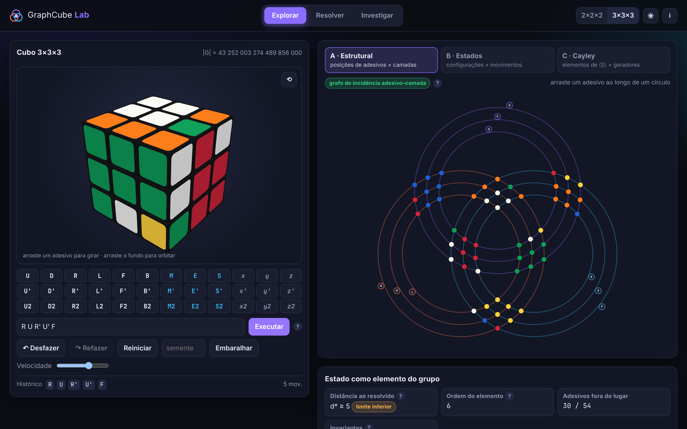
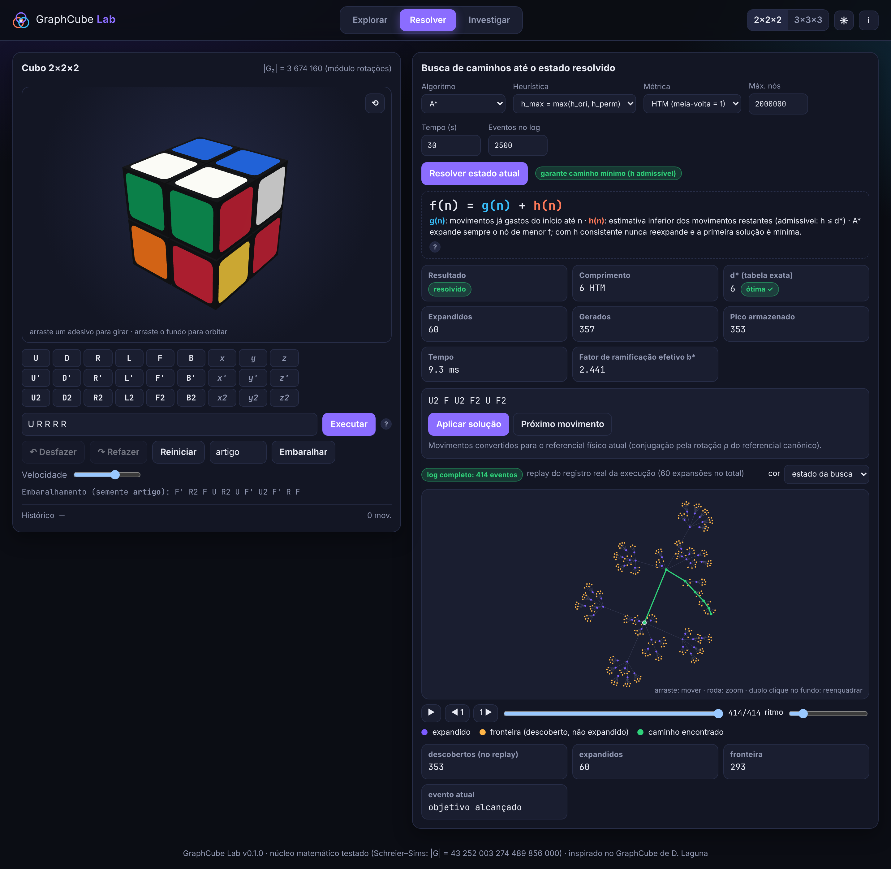

# GraphCube Lab

**Plataforma interativa para exploração matemática e computacional do cubo mágico** —
teoria dos grupos, três representações em grafos, algoritmos de busca com heurísticas
admissíveis e experimentos reprodutíveis, acompanhados de um artigo técnico em LaTeX.



| | |
|---|---|
| **Aplicação** | React + TypeScript + Three.js + Web Workers (`app/`) |
| **Artigo** | [`paper/main.pdf`](paper/main.pdf) (20 p., português, resumo em inglês) |
| **Dados** | [`experiments/results/`](experiments/results) (JSON + CSV com metadados) |
| **Testes** | 55 testes automatizados (Vitest) |
| **Licença** | MIT (código deste projeto) |

---

## 1. Motivação

O projeto [GraphCube](https://github.com/DorianLaguna/GraphCube), de Dorian Laguna,
mostra o cubo como famílias de círculos concêntricos cujas interseções são adesivos.
A análise do seu código ([`docs/01`](docs/01-analise-graphcube-original.md)) mostra que esse
desenho é um **grafo de incidência entre posições de adesivos e camadas** — não um grafo de
estados nem um grafo de Cayley — e que não há modelo de estado, notação, grupo ou algoritmo.

O GraphCube Lab preserva a experiência visual (agora construída geometricamente de forma
exata) e a insere num arcabouço rigoroso:

| Representação | Vértices | Arestas | Na interface |
|---|---|---|---|
| **A · Estrutural** | 6n² posições de adesivos (+ 3n camadas) | pertença a uma camada | círculos/pontos; arraste ao longo de um círculo gira a camada |
| **B · Estados** | configurações completas | movimentos | explorado localmente a partir do estado atual |
| **C · Cayley** | elementos de ⟨S⟩ | multiplicação por geradores | bola em torno de e; \|⟨S⟩\| exato por Schreier–Sims |

## 2. Funcionalidades

**Explorar** — cubos 2×2×2 e 3×3×3; arraste direto nos adesivos, botões e teclado
(`U D R L F B M E S x y z`, Shift = inverso, Ctrl+Z/Y); sequências com grupos e expoentes
(`(R U R' U')6`); histórico, desfazer/refazer, embaralhar com semente, velocidade.
Painel matemático: ciclos de cantos/arestas com torções, ordem do elemento, invariantes
(paridades, Σ torções, Σ inversões), legalidade, distância exata (2×2×2) ou limite inferior
(3×3×3), calculadora de comutadores e conjugados. Grafo de estados com expansão local,
estados repetidos e **detecção de ciclos = relações** (ex.: R⁴ = e). Grafos de Cayley para
qualquer conjunto de geradores: ordem, esferas, diâmetro, cintura e relação mínima,
simetrias, sempre rotulados como parciais quando for o caso.

**Resolver** — BFS, BFS bidirecional, A\*, IDA\* (2×2×2 e 3×3×3), tabela exata (2×2×2) e
duas fases de Kociemba (3×3×3). Estatísticas (expandidos, gerados, pico de memória, tempo,
b\*), garantia de otimalidade explícita, `f = g + h` explicado, e **replay do log real** de
eventos da busca (descobertos, expandidos, fronteira, caminho).



**Investigar** — os mesmos protocolos experimentais da CLI, executados no navegador, com
gráficos, tabelas-resumo e exportação JSON/CSV; importa os resultados da CLI.

## 3. Fundamentação matemática (resumo)

* **Convenção.** Estado = permutação s de Ω (posição → adesivo). Produto (g·h)(i) = g(h(i)).
  Executar o giro X é s ↦ s·m_X, logo palavras são lidas na ordem de execução e
  w ↦ s_w é um homomorfismo.
* **Fonte única de verdade.** Adesivos = (posição, normal) ∈ ℤ³×ℤ³; giros = rotações de
  −90° (Rodrigues). Todas as permutações, tabelas de cubinhos e o diagrama estrutural são
  derivados; as tabelas de Kociemba são usadas apenas como oráculo de teste.
* **Grupos.** G = ⟨U,D,R,L,F,B⟩ (centros fixos); G₂ = ⟨U,R,F⟩ para o 2×2×2 (canto DBL fixo,
  normalização por rotação global). Primeira Lei: (σ,x,τ,y) alcançável ⇔ sgn σ = sgn τ,
  Σx ≡ 0 (3), Σy ≡ 0 (2).
* **Heurísticas.** PDBs (distâncias exatas em projeções) são admissíveis e consistentes; o
  máximo preserva ambas; ⌈peças fora/4⌉ é consistente.

Detalhes e demonstrações: [`docs/03`](docs/03-fundamentacao-matematica.md) e o artigo.

## 4. Validação contra a literatura

| Verificação | Resultado |
|---|---|
| \|G\| por Schreier–Sims | 43 252 003 274 489 856 000 ✓ |
| \|⟨R,U⟩\|, grupo dos quadrados, H de Kociemba, ⟨R2,U2⟩ | 73 483 200 · 663 552 · 19 508 428 800 · 12 ✓ |
| \|G₂\|, \|⟨R,U⟩\| no 2×2×2 | 3 674 160 · 29 160 ✓ |
| Distribuição de distâncias do 2×2×2 (HTM e QTM, BFS completa) | idêntica à publicada (diâmetros 11 e 14) ✓ |
| Esferas iniciais do 3×3×3 (HTM / QTM) | 1, 18, 243, 3240, 43239, 574908 / 1, 12, 114, 1068, … ✓ |
| Tabelas de facelets de Kociemba | reproduzidas a partir da geometria ✓ |

## 5. Instalação e execução

Requisitos: Node.js ≥ 18 (testado com 22), npm; Python ≥ 3.10 para a análise; TeX Live
com `biber` e `latexmk` para o artigo.

```bash
git clone <este repositório> graphcube-lab
cd graphcube-lab/app
npm install
npm run dev          # http://localhost:5173
```

```bash
npm test             # 55 testes (≈ 20 s; inclui tabelas do 3×3×3)
npm run build        # build de produção em app/dist (site estático)
npm run typecheck
```

### Experimentos e análise

```bash
cd app
npm run experiments              # E0–E4 completos (≈ 11 min em 4 núcleos)
npm run experiments -- --quick   # versão reduzida
npm run experiments -- --only E2 --seed 123
cd ..
pip install numpy pandas matplotlib scipy
python3 experiments/analysis/analyze.py   # figuras, tabelas e macros do artigo
```

### Artigo

```bash
cd paper
make            # latexmk -pdf main.tex
```

Todos os números do texto vêm de [`paper/generated/numbers.tex`](paper/generated/numbers.tex),
gerado pela análise — o texto não contém valores digitados à mão.

## 6. Exemplos de uso

* Digite `(R U R' U')6` e execute: o cubo volta ao resolvido; no grafo de estados aparece
  um ciclo de comprimento 24, uma relação do grupo.
* Calculadora de grupo: `A = R U` → ordem 105. `A = R`, `B = L` → [A,B] = e (comutam).
* Aba Cayley → preset `⟨R2,U2⟩`: grupo de ordem 12, grafo = ciclo de 12 vértices.
* 2×2×2 → Embaralhar → Resolver com A\* e `h_max`: solução com comprimento = d\* (marcada
  "ótima ✓") e replay da busca.
* 3×3×3 → Embaralhar → Resolver com duas fases: ~20 movimentos em ~100 ms (válida, **não**
  necessariamente mínima — e a interface diz isso).

## 7. Estrutura do repositório

```
app/                    aplicação web + CLI
  src/core/             permutações, geometria, notação, cubinhos, simetrias, Schreier–Sims, PRNG
  src/search/           BFS, bidirecional, A*, IDA*, PDBs, 2×2×2 exato, 3×3×3, duas fases
  src/graph/            grafo estrutural, grafo de estados, explorador de Cayley
  src/experiments/      protocolos E0–E4 (compartilhados por navegador e CLI)
  src/workers/          Web Worker + cliente
  src/viz3d/ vizgraph/  renderização (sem lógica matemática)
  src/ui/               componentes React (Explorar / Resolver / Investigar)
  tests/                testes Vitest
  scripts/              CLI de experimentos
experiments/results/    dados brutos (JSON/CSV)  ·  analysis/analyze.py  ·  figures/
paper/                  artigo LaTeX (main.tex, sections/, refs.bib, generated/, main.pdf)
docs/                   análise do original, planejamento, fundamentos, algoritmos,
                        experimentos, decisões, revisão final
```

## 8. Documentação

1. [Análise do GraphCube original](docs/01-analise-graphcube-original.md)
2. [Planejamento científico e computacional](docs/02-planejamento.md)
3. [Fundamentação matemática](docs/03-fundamentacao-matematica.md)
4. [Algoritmos](docs/04-algoritmos.md)
5. [Experimentos](docs/05-experimentos.md)
6. [Revisão final e consistência](docs/06-revisao-final.md)
7. [Registro de decisões](docs/DECISIONS.md)

## 9. Limitações

* Busca ótima no 3×3×3 só é viável para estados próximos (IDA\* com h_PDB: d\* ≤ 12 em
  segundos); estados aleatórios usam duas fases (não ótimo).
* BFS/A\* no 3×3×3 esgotam memória rapidamente — o limite de nós é respeitado e reportado.
* Memória é medida em estados armazenados, não bytes; tempos vêm de um único ambiente.
* A análise do GraphCube baseou-se no código-fonte: o site publicado e o fórum Three.js não
  estavam acessíveis no ambiente de desenvolvimento.

## 10. Licenças e atribuições

* Código do GraphCube Lab: **MIT** ([LICENSE](LICENSE)).
* **GraphCube** (Dorian Laguna): inspiração para o diagrama estrutural. O repositório
  original não declara licença; **nenhum código, modelo 3D ou imagem dele foi reutilizado**.
* Dependências: React (MIT), Three.js (MIT), d3-force (ISC), Vite (MIT), Vitest (MIT).
* Referências científicas: ver `paper/refs.bib`.
